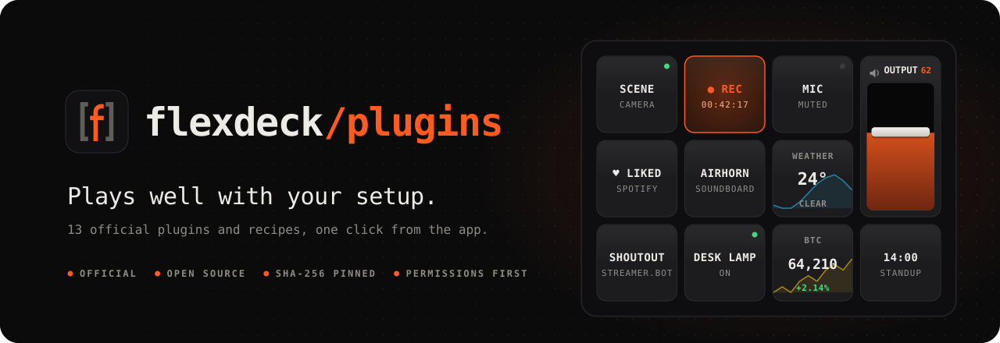

<a href="https://flex-deck.com">
  <picture>
    <source media="(prefers-color-scheme: dark)" srcset=".github/assets/banner-dark.svg">
    <source media="(prefers-color-scheme: light)" srcset=".github/assets/banner-light.svg">
    
  </picture>
</a>

<p align="center">
  <a href="https://flex-deck.com"></a>
  <a href="https://github.com/Questory-Labs/FlexDeck-Plugins/actions/workflows/ci.yml"></a>
  <a href="https://www.npmjs.com/package/@flexdeck/plugin-sdk"></a>
  <a href="LICENSE"></a>
</p>

<p align="center">
  OBS, Discord, Spotify, Streamer.bot, a soundboard, and live data from the web,<br>
  on the keys of the tablet you already own. <b>Installed from the app, in one click.</b>
</p>

<br>

## The plugins

Open FlexDeck's **Plugins** tab and they're all in the **Marketplace**. Each one's page here walks through any setup it needs.

| Plugin | What you get on the deck | You'll need | Setup |
| --- | --- | --- | :-: |
| **[OBS Studio](plugins/obs)** | Scenes, record, stream, replay, mutes and volume faders, with a red light and timer while you record | OBS 28 or later | 1 min |
| **[Discord](plugins/discord)** | Mute, deafen, push-to-talk, voice channels, everyone's volume, the soundboard, who is speaking | The Discord desktop app, and a free developer app | 3 min |
| **[Spotify](plugins/spotify)** | Like, add to a playlist, start a playlist, move to another speaker, the album art | A free developer app; Premium for playback | 2 min |
| **[Streamer.bot](plugins/streamerbot)** | Run and flip actions, switch them on and off, show global variables | Streamer.bot with its WebSocket server on | 1 min |
| **[Soundboard](plugins/soundboard)** | Clips in your headphones and, through a virtual cable, into your mic | Windows; VB-CABLE to play into your mic | 0–5 min |

And four **recipes**: plugins with no code at all, just a description of a web source and the keys that show it. A recipe can only fetch the address it names. It can't run anything.

| Recipe | What you get on the deck | You'll need | Setup |
| --- | --- | --- | :-: |
| **[Weather](recipes/weather)** | The temperature, the sky and the wind, with today's curve behind | Nothing; no account | 30 s |
| **[Calendar](recipes/calendar)** | Your next event and how soon it starts; red in the last five minutes | Your calendar's secret iCal address | 1 min |
| **[Crypto prices](recipes/crypto)** | A coin's price and its change today, with the last day behind | Nothing; no account | 30 s |
| **[Home Assistant](recipes/home-assistant)** | Any entity's state: a sensor's reading, a light on or off | Home Assistant on your network, and a token | 2 min |

## Install one

1. In the FlexDeck desktop app, open **Plugins → Marketplace**. The *Plugins* tab at [flex-deck.com](https://flex-deck.com) shows the same list.
2. Pick a plugin. Its tile shows who made it, its version, and what it may do.
3. Press **Install**, read the permissions it asks for, and accept them. Nothing installs until you do.
4. If the plugin's page here has a *Set up* section, follow it. Then give your keys its actions in the editor, or start from the ready-made keys it adds to the gallery.

FlexDeck re-reads this repository every six hours or so and offers new versions under the **Updates** chip.

## Can I trust them?

- **What you install is what was built here.** Every package is built by CI from this repository's source. The index pins each package's SHA-256, and FlexDeck checks it before installing. A published package is never rebuilt or replaced.
- **Permissions come first.** A plugin declares what it may do (`network`, `notifications`, `processes`, `filesystem`), and FlexDeck shows them before installing and enforces them in the agent, not only in the UI.
- **Your secrets stay on your PC.** Client secrets, tokens and passwords live in the plugin's settings on your computer. Nothing is sent to us, and there is no FlexDeck account to send it to.
- **Plugins are still programs.** A plugin runs as a process with your account's rights, so permissions are a declaration you agree to, not a sandbox. That's why everything here is open source: read what a plugin does before you install it.

## Write your own

Plugins are small programs that speak a line-based JSON protocol, so you can write one in anything. The SDKs build, test, pack and verify for you:

```sh
npm create flexdeck-plugin lights "Desk lights"
```

| Language | SDK |
| --- | --- |
| TypeScript / JavaScript | [`@flexdeck/plugin-sdk`](https://www.npmjs.com/package/@flexdeck/plugin-sdk) |
| Python | [`flexdeck`](https://github.com/santoshpanna/FlexDeck/tree/main/packages/plugin-sdk-python) |
| Rust | [`flexdeck-plugin-sdk`](https://crates.io/crates/flexdeck-plugin-sdk) |
| No code (a web source) | a recipe, like the [ones here](recipes) |

The [plugin guide](https://github.com/santoshpanna/FlexDeck/blob/main/docs/plugins.md) is the full reference. You don't need to be listed here to publish: a repository is just a static `repository.min.json` and its packages, and anyone can add yours under *Repositories → Add a repository by address*. See [CONTRIBUTING.md](CONTRIBUTING.md) to get it listed under *Community*, or to add a plugin to this repository.

<br>

---

<br>

## For maintainers

### Layout

| Path | What |
| --- | --- |
| `plugins/<id>/` | A plugin's source: `plugin.json`, `package.json`, `src/`, `test/`, and its `README.md` |
| `recipes/<id>/` | A recipe: `plugin.json` and `recipe.json`, no code |
| `examples/` | Reference plugins that are tested but not published. `weather-node` is the ABI 4 reference in TypeScript (the published `weather` is the recipe) |
| `icons/` | `<id>.png` and `<id>-<px>.png`, picked up by the index |
| `packages/` | Every released `<id>-<version>.fdpkg`, written by CI and never changed. Pre-releases go in `packages/pre/`, which the index doesn't read |
| `repository.min.json`, `repository.json` | The index the app reads, written by CI |
| `repositories.min.json` | The community repositories FlexDeck has reviewed (the app's *Community* list) |
| `.github/assets/` | The README artwork, written by `pnpm art` |

The app reads the index from:

```
https://raw.githubusercontent.com/Questory-Labs/FlexDeck-Plugins/main/repository.min.json
```

### Changing a plugin

Merging a change doesn't ship it. Each plugin is released on its own, when you choose.

1. Change the code and its tests. Describe each change for users in the commit, one typed line per change: `feat(obs): …`, `fix(obs): …`, `perf(obs): …` or `sec(obs): …`. These lines become the release notes. A line without a scope counts for the plugin whose folder the commit touches, and `chore`, `test`, `docs` and `ci` lines are left out. If you squash-merge, keep these lines in the squash message.
2. Open a pull request. CI runs `pnpm check`, the typechecks and every test, and dry-runs the release script. `pnpm check` also lists the plugins with unreleased changes.
3. Merge it. Main can hold unreleased changes for any number of plugins.

### Releasing a plugin

**Actions → Release plugin → Run workflow.** Pick the plugin, and the version: `patch`, `minor`, `major`, an exact one (`1.2.0`, `1.2.0-rc.1`), or blank to release the version already in the code. Or push to `main` with a `release(<id>): v<version>` line in a commit message: each such line releases that plugin at that version. It then:

1. writes the version into `plugin.json`, `package.json` and the code (`src/index.ts`, or `Cargo.toml` for a native plugin), tests the plugin, and commits `release(<id>): v<version>` to `main`;
2. builds and packs only that plugin, on Windows for a native one and on Linux otherwise;
3. adds the package to `packages/` and rewrites `repository.min.json` so it lists this version as the plugin's newest, then commits both to `main`. FlexDeck offers the update within six hours;
4. cuts the GitHub release `<id>-v<version>`, with the `.fdpkg` attached and the notes from the plugin's typed lines since its previous release.

A version that is already released, or older than the newest one, is refused. A pre-release (`1.2.0-rc.1`) gets a GitHub pre-release only. It stays out of the index, so nobody is updated to it, and the final `1.2.0` lists everything since the release before the rc. Other plugins in the index never change when you release one. Two releases can run at once: the publish step retries on a moved `main`.

If a run fails after step 1, run it again with the version blank. To set a version without releasing, use `pnpm bump <id> <patch | minor | major | version>`.

### Working locally

```sh
pnpm install
pnpm test                 # every plugin's tests, and the soundboard's cargo tests
pnpm typecheck
pnpm check                # the rules above
pnpm build                # pack each new version into packages/ and rewrite the index
pnpm bump <id> patch      # a new version, everywhere the plugin writes it
pnpm art                  # redraw the README artwork in .github/assets/
```

Plugins are built with the published SDKs: [`@flexdeck/plugin-sdk`](https://www.npmjs.com/package/@flexdeck/plugin-sdk) on npm and [`flexdeck-plugin-sdk`](https://crates.io/crates/flexdeck-plugin-sdk) on crates.io. To build against a checkout of the app instead, for example while changing the SDK:

```sh
pnpm link-sdk ../flexdeck # links the npm SDK and patches the crates (.cargo/config.toml, gitignored)
```

Delete `.cargo/config.toml` and run `pnpm install` to go back to the published SDKs.

To check a package against the FlexDeck on your computer:

```sh
flexdeck verify-plugin packages/obs-0.4.0.fdpkg
```

To try the whole repository in the app, serve this folder (for example `npx serve -l 8799`) and start the agent with `FLEXDECK_OFFICIAL_REPO=http://127.0.0.1:8799/repository.min.json`.

### Pipeline

| Workflow | Runs on | Does |
| --- | --- | --- |
| `ci.yml` | pull requests, pushes to `main` | `pnpm check`, typecheck and tests (Linux); soundboard tests (Windows); a dry run of the release script |
| `release.yml` | by hand: *Release plugin* | releases one plugin (above) |
| `publish.yml` | by hand: *Publish all* | builds every version that has no package yet, rewrites the index, commits, and creates every missing GitHub release. Use it for the repository's first publish, or to repair a release that failed |

Releases are derived from `packages/`, so a package never gets two releases, and a missing one is made the next time either workflow runs. None is marked *latest*, since each plugin has its own line of releases. To preview the notes locally, run `node scripts/release.mjs --dry-run [--only <id>]`.

Before the first push, the SDKs must be on npm and crates.io (the app repository's *Plugin SDKs* workflow). Then run `pnpm install` and `cargo generate-lockfile` without `link-sdk`, and commit `pnpm-lock.yaml` and `Cargo.lock`: CI installs with `--frozen-lockfile`. Then run *Publish all* once to release every plugin's first version.

The workflows need *Settings → Actions → General → Workflow permissions: Read and write*, so Publish can commit. If `main` is protected, let `github-actions[bot]` push to it.

## Licence

MIT. See [LICENSE](LICENSE). Each plugin is MIT too, unless its folder says otherwise.
