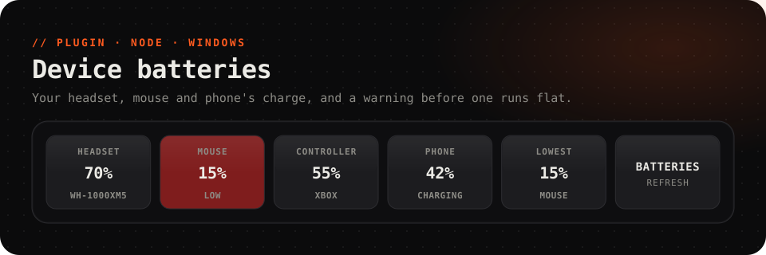

<picture>
  <source media="(prefers-color-scheme: dark)" srcset="../../.github/assets/batteries-dark.svg">
  <source media="(prefers-color-scheme: light)" srcset="../../.github/assets/batteries-light.svg">
  
</picture>

<p align="center">
  <a href="https://github.com/Questory-Labs/FlexDeck-Plugins/releases?q=batteries-v&expanded=true"></a>
  
  
  
</p>

<p align="center">
  The charge of your Bluetooth headset, mouse and controller, and of your Android phone,<br>
  with <b>a warning before one runs flat</b>.
</p>

<br>

## Set up

**Bluetooth:** nothing to set. Any device Windows shows a battery for, in **Settings → Bluetooth & devices**, shows up here.

**Android phones** (optional, about 3 minutes):

1. Install Android's [platform tools](https://developer.android.com/tools/releases/platform-tools) and note where `adb` is.
2. On the phone, turn on **Developer options → USB debugging** (or **Wireless debugging**), plug it in and allow this computer.
3. In the FlexDeck desktop app, open **Plugins → Device batteries → Settings** and put `adb`, or its full path, in *adb*.

Readings are taken every minute, and only while a key shows one.

## Ready-made keys

| Key | Look |
| --- | --- |
| **Battery** | One device's charge; red when it runs low. Pick the device in *Its own data* |
| **Lowest battery** | Whichever connected device is emptiest, and its charge |

## Keys to try

<table>
<tr><th>Key</th><th>How</th></tr>
<tr>
<td><b>Headset charge</b></td>
<td><i>Label shows:</i> <code>{{batteries.wh_1000xm5.level}}%</code>, with your headset's name in place of <code>wh_1000xm5</code></td>
</tr>
<tr>
<td><b>Charge me</b></td>
<td><i>Light up while:</i> <code>batteries.lowest.level < 20</code>, <i>Label shows:</i> <code>{{batteries.lowest.name}}</code></td>
</tr>
<tr>
<td><b>A notification</b></td>
<td>Tick <i>notify</i>, or start an automation from the <code>low</code> event.</td>
</tr>
</table>

The PC's own battery is in the built-in **Sensors**.

## Reference

<details>
<summary><b>Actions</b> (1)</summary>

| Action | Id | Notes |
| --- | --- | --- |
| Read every battery now | `refresh` | |

</details>

<details>
<summary><b>Values</b> for labels, lights and conditions</summary>

`<device>` is the device's name in lower case, with anything but letters and digits turned into `_`: `MX Master 3S` → `mx_master_3s`.

| Value | |
| --- | --- |
| `batteries.<device>.level` | Its charge, % |
| `batteries.<device>.online` | It is connected |
| `batteries.<device>.charging` | It is charging (phones) |
| `batteries.<device>.name` | Its name |
| `batteries.count` | How many devices report a charge |
| `batteries.lowest.level`, `batteries.lowest.name` | The emptiest connected device |

</details>

<details>
<summary><b>Events</b> for automations</summary>

| Event | Carries |
| --- | --- |
| `low` | `device`, `level` |
| `charging_started` | `device`, `level` |
| `charging_stopped` | `device`, `level` |

</details>

<details>
<summary><b>Settings</b></summary>

| Setting | |
| --- | --- |
| *bluetooth* | Read Bluetooth devices. Default on |
| *adb* | `adb`, or its full path, to read Android phones. Empty skips phones |
| *every* | Seconds between readings, at least 10. Default `60` |
| *low* | Below this charge a device counts as low. Default `20` |
| *notify* | Show a notification when a device runs low |

</details>

## Troubleshooting

<details>
<summary><b>A Bluetooth device is missing</b></summary>

Only devices that tell Windows their charge can be shown: if **Settings → Bluetooth & devices** shows no percentage for it, neither can the plugin. Devices on their own USB dongle usually report only to their maker's app.
</details>

<details>
<summary><b>"spawn adb ENOENT"</b> or no phone</summary>

*adb* must name the program: put its full path, for example `C:\platform-tools\adb.exe`. Run `adb devices` yourself: the phone must be listed as `device`, not `unauthorized`.
</details>

## Development

```sh
pnpm --filter @flexdeck/plugin-batteries test
pnpm --filter @flexdeck/plugin-batteries verify
pnpm --filter @flexdeck/plugin-batteries package   # batteries-<version>.fdpkg
```
