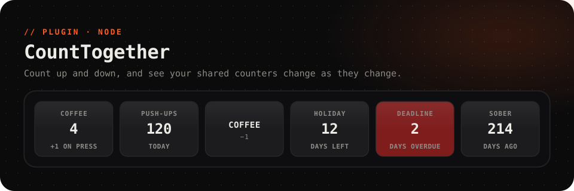

<picture>
  <source media="(prefers-color-scheme: dark)" srcset="../../.github/assets/counttogether-dark.svg">
  <source media="(prefers-color-scheme: light)" srcset="../../.github/assets/counttogether-light.svg">
  
</picture>

<p align="center">
  <a href="https://github.com/Questory-Labs/FlexDeck-Plugins/releases?q=counttogether-v&expanded=true"></a>
  
  
</p>

<p align="center">
  Count up and down from the deck and show your CountTogether counters and countdowns,<br>
  <b>updated the moment anyone you share them with changes them</b>.
</p>

<br>

## Set up

About a minute.

1. In the CountTogether app, open **Settings → API Token** and press **Show API token**. Copy it.
2. In the FlexDeck desktop app, open **Plugins → CountTogether → Settings**, paste it into *token*, and save.

The token is kept as a secret on this PC. The plugin connects at once and stays connected, so changes made in the app or by anyone you share a counter with show on the keys straight away.

## Ready-made keys

| Key | Press | Look |
| --- | --- | --- |
| **Counter** | Counts it up. Pick the counter under *Does* | The counter's name and count |
| **Countdown** | | Days left to a countdown; red once it is overdue |

Pick the counter in *Its own data*; your counters are offered by name.

## Keys to try

<table>
<tr><th>Key</th><th>How</th></tr>
<tr>
<td><b>Plus and minus</b></td>
<td>Two keys: <b>Count a counter up</b> and <b>Count a counter down</b> on the same counter. Give an <i>amount</i> to count by more than one.</td>
</tr>
<tr>
<td><b>Back to zero</b></td>
<td><i>Does:</i> <b>Set a counter to a number</b> with <code>0</code>.</td>
</tr>
<tr>
<td><b>Move a countdown</b></td>
<td><i>Does:</i> <b>Move a date counter's date</b> with <code>2026-12-24</code>.</td>
</tr>
<tr>
<td><b>Celebrate a milestone</b></td>
<td>An automation on the <code>changed</code> event with the condition <code>value == 100</code>.</td>
</tr>
</table>

## Reference

<details>
<summary><b>Actions</b> (4)</summary>

`counter` takes a counter's name or its id.

| Action | Id | Notes |
| --- | --- | --- |
| Count a counter up | `increment` | `counter`, `amount` (empty counts by the counter's own step) |
| Count a counter down | `decrement` | `counter`, `amount` |
| Set a counter to a number | `set_value` | `counter`, `value` |
| Move a date counter's date | `set_date` | `counter`, `date` as `YYYY-MM-DD`: the start it counts from, or the day it counts down to |

</details>

<details>
<summary><b>Values</b> for labels, lights and conditions</summary>

`<counter>` is the counter's name in lower case, with anything but letters and digits turned into `_`: `Tägliche Übung` → `taegliche_uebung`.

| Value | |
| --- | --- |
| `counttogether.connected`, `counttogether.error` | Connected, and why not if it is not |
| `counttogether.counter.<counter>.value` | Its count, or its days for a date counter |
| `counttogether.counter.<counter>.label` | The same as words: `3 days left` |
| `counttogether.counter.<counter>.name` | Its name |
| `counttogether.counter.<counter>.date` | A date counter's date, `YYYY-MM-DD` |

</details>

<details>
<summary><b>Events</b> for automations</summary>

| Event | Carries |
| --- | --- |
| `changed` | `counter`, `id`, `value`, `previous`, `change` |
| `deleted` | `counter`, `id` |

</details>

<details>
<summary><b>Settings</b></summary>

| Setting | |
| --- | --- |
| *token* | Your CountTogether API token. Kept as a secret on this PC |

</details>

## Troubleshooting

<details>
<summary><b>"CountTogether refused the API token"</b></summary>

The token was changed or revoked in the app. Copy it again from **Settings → API Token** and paste it into *token*.
</details>

<details>
<summary><b>"too many changes at once"</b></summary>

CountTogether takes a few changes a second. Hold off a moment; the next press goes through.
</details>

## Development

```sh
pnpm --filter @flexdeck/plugin-counttogether test      # against a fake CountTogether
pnpm --filter @flexdeck/plugin-counttogether verify
pnpm --filter @flexdeck/plugin-counttogether package   # counttogether-<version>.fdpkg
```
