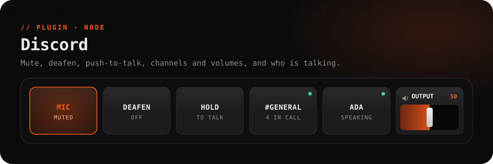

<picture>
  <source media="(prefers-color-scheme: dark)" srcset="../../.github/assets/discord-dark.svg">
  <source media="(prefers-color-scheme: light)" srcset="../../.github/assets/discord-light.svg">
  
</picture>

<p align="center">
  <a href="https://github.com/Questory-Labs/FlexDeck-Plugins/releases?q=discord-v&expanded=true"></a>
  
  
  
</p>

<p align="center">
  Mute, deafen and push-to-talk from a key. Pick Discord's mic and speakers, set everyone's volume<br>
  on a fader, hop between voice channels, fire the soundboard, and <b>see who is speaking</b>, live.
</p>

<br>

> [!IMPORTANT]
> **This plugin needs about three minutes of setup.** Discord only lets an *application* control voice once Discord has approved it, or for the person who created it. FlexDeck doesn't have an approved application yet, so you create your own. It's free, it's yours, and it stays on your computer. The steps are below.

## Contents

- [Before you start](#before-you-start)
- [Set up](#set-up)
- [Keys to try](#keys-to-try)
- [What Discord allows](#what-discord-allows)
- [Reference](#reference): actions, values, events, settings
- [Troubleshooting](#troubleshooting)
- [Privacy](#privacy)

## Before you start

- **The Discord desktop app** must be running and signed in **on the same PC as FlexDeck**. The plugin talks to it through Discord's local RPC, the private channel the desktop app opens on your computer. Discord in a browser can't be reached this way. Stable, PTB and Canary all work.
- **The same Discord account** in the desktop app and in the Developer Portal. An application you haven't been approved for only works for the account that created it.

## Set up

### 1. Create your Discord application

1. Open the **[Discord Developer Portal](https://discord.com/developers/applications)** and sign in with the account you use in the Discord app.
2. Press **New Application** in the top right. Name it anything (`FlexDeck` is fine), accept the terms, and press **Create**.

### 2. Copy its keys and add a redirect

On the left, open **OAuth2**.

1. Under **Client information**, press **Copy** under **Client ID** and keep it handy.
2. Press **Reset Secret**, confirm, and copy the **Client Secret** it shows. Discord shows it only once. If you lose it, reset it again.
3. Under **Redirects**, press **Add Redirect** and enter exactly:

   ```
   http://127.0.0.1
   ```

   No trailing slash and no port. It must match the plugin's *redirect uri* setting, which is `http://127.0.0.1` unless you change it.
4. Press **Save Changes** in the bar at the bottom.

> [!NOTE]
> You don't need a bot, an install link or anything under *Bot*. Leave the rest of the application as it is.

### 3. Paste them into FlexDeck

1. In the FlexDeck desktop app, open **Plugins**, find **Discord**, and open its **Settings**.
2. Paste the **Client ID** into *client id* and the **Client Secret** into *client secret*.
3. Save.

### 4. Let it in

1. Put any Discord action on a key, **Mute or unmute your microphone** for example, and press it.
2. **Switch to the Discord app.** It shows a dialog asking whether to let your application in, listing what it may do. It can open behind other windows, so check the taskbar.
3. Press **Authorize**.

That's it. You won't be asked again: the plugin keeps its sign-in fresh by itself. The dialog waits two minutes. If it times out or you press *Cancel*, press any Discord key to ask again.

> [!TIP]
> **Check it worked:** set a key's *Light up while* to `discord.authorized`. It lights once Discord has let FlexDeck in.

## Keys to try

<table>
<tr><th>Key</th><th>How</th></tr>
<tr>
<td><b>Mute, with a light</b></td>
<td><i>Does:</i> <b>Mute or unmute your microphone</b>.<br><i>Light up while:</i> <code>discord.voice.mute</code></td>
</tr>
<tr>
<td><b>Push-to-talk</b></td>
<td>Under <b>While held</b>, put <b>Push-to-talk: open the microphone</b> on <i>When pressed</i> and <b>Push-to-talk: close the microphone</b> on <i>When let go</i>.<br>It works by unmuting while held, so set Discord to <b>Voice Activity</b> and start muted. If the tablet loses its connection while you hold the key, the desktop lets go for you, so your mic is never left open.</td>
</tr>
<tr>
<td><b>Who's in the call</b></td>
<td><i>Label shows:</i> <code>{{discord.voice.channel}}</code> on top, <code>{{discord.voice.users}} in call</code> beneath.</td>
</tr>
<tr>
<td><b>A friend's key</b></td>
<td><i>Does:</i> <b>Mute or unmute one person for yourself</b>, picking them from the list.<br><i>Light up while:</i> <code>discord.user.&lt;id&gt;.speaking</code>, so it glows when they talk.</td>
</tr>
<tr>
<td><b>Faders</b></td>
<td><b>Set your microphone's volume in Discord</b> (0–100), <b>Set Discord's output volume</b> (0–200, as in Discord) and <b>Set one person's volume in your call</b> (0–200) can each drive a slider. The slider follows changes you make in Discord too.</td>
</tr>
<tr>
<td><b>Jump to a channel</b></td>
<td><i>Does:</i> <b>Join a voice channel</b>, picking it from the list. Turn on <i>force</i> to move even when you're already in another call.</td>
</tr>
<tr>
<td><b>Unread pings</b></td>
<td><i>Label shows:</i> <code>{{discord.notifications.count}}</code>, and <i>Does:</i> <b>Reset the notification count</b> to clear it once you've caught up.</td>
</tr>
</table>

Channels, people, devices and sounds are offered as a list while you edit the key, as long as Discord is connected. To type an id yourself, turn on **User Settings → Advanced → Developer Mode** in Discord, then right-click a channel or person and choose **Copy ID**.

## What Discord allows

- **Video, screen share and the soundboard** use commands Discord hasn't made public. The plugin tries them rather than assuming they work. If your Discord doesn't offer one, the key says so plainly. Video and screen share may also need extra permissions: put `rpc.video.write rpc.screenshare.write` in *extra scopes* if your application is allowed them.
- **Server stats** are what local RPC can see: the server's name, its voice channels, and how many people are in them. RPC doesn't report member or online counts. To get the online count, turn on *use guild widget*, which reads it from the server's public widget. The server must have its widget switched on (**Server Settings → Widget**).
- **Notifications** counts what Discord shows on this computer, from when the plugin started or was last cleared.

## Reference

<details>
<summary><b>Actions</b> (21)</summary>

| Action | Id | Notes |
| --- | --- | --- |
| Mute or unmute your microphone | `toggle_mute` | |
| Set your microphone muted or not | `set_mute` | `muted`: true / false |
| Deafen or undeafen | `toggle_deafen` | |
| Set deafened or not | `set_deafen` | `deaf`: true / false |
| Push-to-talk: open the microphone | `ptt_start` | Put on *When pressed* |
| Push-to-talk: close the microphone | `ptt_end` | Put on *When let go* |
| Switch between voice activity and push-to-talk | `toggle_voice_mode` | Reports `vad` or `ptt` |
| Use voice activity or push-to-talk | `set_voice_mode` | `VOICE_ACTIVITY` or `PUSH_TO_TALK` |
| Join a voice channel | `join_voice` | `channel`, `force` |
| Leave the voice channel | `leave_voice` | |
| Open a text channel in Discord | `select_text_channel` | `channel` |
| Choose Discord's microphone | `set_input_device` | `device` |
| Choose Discord's speakers | `set_output_device` | `device` |
| Set your microphone's volume in Discord | `set_input_volume` | 0–100, slider |
| Set Discord's output volume | `set_output_volume` | 0–200, slider |
| Set one person's volume in your call | `set_user_volume` | `user`, 0–200, slider |
| Mute or unmute one person for yourself | `toggle_user_mute` | `user`; reports `muted` or `live` |
| Play a soundboard sound in your call | `play_sound` | `sound`; not public, see above |
| Turn your camera on or off in the call | `toggle_video` | Not public, see above |
| Start or stop sharing your screen | `toggle_screenshare` | Not public, see above |
| Reset the notification count | `clear_notifications` | |

</details>

<details>
<summary><b>Values</b> for labels, lights and conditions</summary>

| Value | |
| --- | --- |
| `discord.connected` | The Discord app is reachable |
| `discord.authorized` | Discord let FlexDeck in |
| `discord.user` | Who is signed in to Discord |
| `discord.voice.mute`, `discord.voice.deaf` | You're muted, deafened |
| `discord.voice.mode` | `VOICE_ACTIVITY` or `PUSH_TO_TALK` |
| `discord.voice.input_volume`, `discord.voice.output_volume` | Discord's mic and output volume, % |
| `discord.voice.input_device`, `discord.voice.output_device` | The mic and speakers Discord uses |
| `discord.voice.channel`, `discord.voice.channel_id` | The voice channel you're in |
| `discord.voice.guild` | The server it's on |
| `discord.voice.users` | How many are in the call |
| `discord.voice.connection` | The voice connection's state |
| `discord.speaking` | You are speaking |
| `discord.user.<id>.volume` | That person's volume, % |
| `discord.user.<id>.muted` | You've muted that person |
| `discord.user.<id>.speaking` | That person is speaking |
| `discord.notifications.count` | Notifications since the last reset |
| `discord.notifications.last_title`, `discord.notifications.last_body` | The latest one |
| `discord.stats.guild_name` | The stats server's name |
| `discord.stats.voice_channels` | How many voice channels it has |
| `discord.stats.in_voice` | How many people are in them |
| `discord.stats.online` | How many are online (needs the widget) |

The `discord.user.<id>.*` values exist for each person in your call, and come and go as they join and leave.

</details>

<details>
<summary><b>Events</b> for automations</summary>

| Event | Carries |
| --- | --- |
| `connected` | |
| `disconnected` | `reason` |
| `notification` | `channel_id`, `title`, `body` |
| `voice_channel_changed` | `channel_id`, `guild_id` |
| `user_joined`, `user_left` | `user_id`, `name` |
| `speaking_started`, `speaking_stopped` | `user_id` |

</details>

<details>
<summary><b>Settings</b></summary>

| Setting | |
| --- | --- |
| *client id* | Your application's Client ID |
| *client secret* | Your application's Client Secret, kept as a secret on this PC |
| *redirect uri* | A redirect your application lists. Default `http://127.0.0.1` |
| *extra scopes* | More permissions to ask for, space-separated (video, screen share) |
| *stats guild* | The server the stats describe: its id or name. Blank means the one you're in a call on |
| *use guild widget* | Read the online count from the server's public widget |
| *access token*, *refresh token*, *expires at* | Kept by the plugin. Clear the two tokens to sign out |
| *api base* | Discord's API. Leave it as it is |

</details>

## Troubleshooting

<details>
<summary><b>"set your Discord application's Client ID in this plugin's settings"</b></summary>

The plugin has no application to sign in as. Follow [Set up](#set-up) from step 1, and make sure you saved the settings.
</details>

<details>
<summary><b>"Discord is not connected"</b></summary>

The plugin can't find the Discord app. Make sure the **desktop app** is running and signed in on this PC, not Discord in a browser. If you just started Discord, give it a few seconds: the plugin retries by itself, waiting a little longer each time, up to every 30 seconds.
</details>

<details>
<summary><b>The Authorize dialog never appears</b></summary>

- It opens **inside the Discord app**, which may be behind other windows or minimised to the tray. Bring Discord to the front and press the key again.
- If you pressed *Cancel* or waited more than two minutes, the plugin doesn't ask again on its own, because the dialog would keep popping up. Press any Discord key to ask again.
</details>

<details>
<summary><b>"Discord refused the sign-in: …"</b></summary>

Discord turned down the exchange after you authorized.

- **`invalid_client`**: the Client Secret is wrong or was reset since you copied it. Reset it again, paste the new one, and save.
- **`invalid_grant`** or a message about **`redirect_uri`**: the redirect in the Developer Portal doesn't match *redirect uri* in the plugin's settings exactly. Both should be `http://127.0.0.1`. Remember to press **Save Changes** in the portal.
</details>

<details>
<summary><b>"Discord did not allow this application to do that"</b></summary>

The account signed in to the Discord app isn't the one that created the application. Sign in to the Developer Portal with the account you use in the Discord app and create the application there. Then paste its Client ID and Secret, and clear *access token* and *refresh token* so it asks again.
</details>

<details>
<summary><b>"this Discord does not let apps do that"</b></summary>

That's the camera, screen share or soundboard, which aren't public commands. Your Discord doesn't offer it to applications, so there's nothing to fix on your side. For the camera and screen share, you can try adding `rpc.video.write rpc.screenshare.write` to *extra scopes*, then clearing the two tokens so Discord asks again.
</details>

<details>
<summary><b>Signing out, or starting over</b></summary>

Clear *access token* and *refresh token* in the plugin's settings. The next key you press shows the Authorize dialog again. To remove FlexDeck's access on Discord's side too, open **User Settings → Authorized Apps** in Discord and press **Deauthorize** on your application.
</details>

The plugin's **Log** (Plugins → Discord → Log) says what it tried and what Discord answered.

## Privacy

Everything stays between FlexDeck and Discord on your PC. Your Client Secret and the sign-in tokens live in this plugin's settings, on this computer. The only network calls go to Discord itself, to exchange and refresh the sign-in. The plugin asks Discord for `rpc`, `rpc.voice.read`, `rpc.voice.write`, `rpc.notifications.read`, `identify` and `guilds`, plus any *extra scopes* you add.

## Development

```sh
pnpm --filter @flexdeck/plugin-discord test      # against a fake Discord on a real named pipe
pnpm --filter @flexdeck/plugin-discord verify    # ask FlexDeck whether the package will work
pnpm --filter @flexdeck/plugin-discord package   # discord-<version>.fdpkg
```
