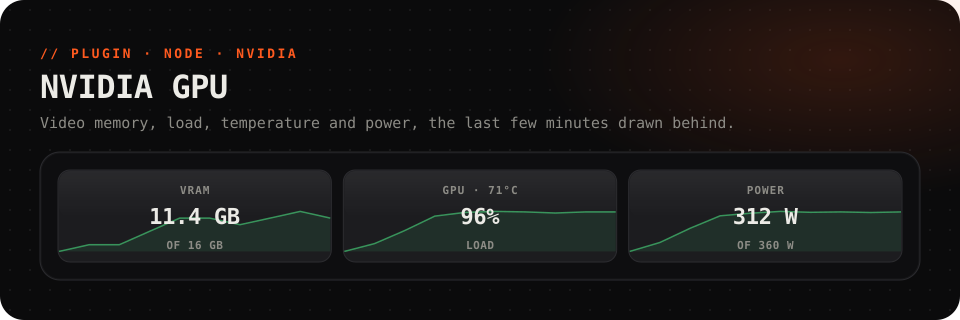

<picture>
  <source media="(prefers-color-scheme: dark)" srcset="../../.github/assets/gpu-dark.svg">
  <source media="(prefers-color-scheme: light)" srcset="../../.github/assets/gpu-light.svg">
  
</picture>

<p align="center">
  <a href="https://github.com/Questory-Labs/FlexDeck-Plugins/releases?q=gpu-v&expanded=true"></a>
  
  
  
</p>

<p align="center">
  Video memory in use, how busy the card is, how hot it runs and what it draws,<br>
  with <b>the last few minutes drawn behind</b>.
</p>

<br>

## Set up

Nothing to set. The plugin reads the card through `nvidia-smi`, which comes with the NVIDIA driver, and finds it by itself.

Readings are taken only while a key shows one, every 2 seconds unless you change *every*.

## Ready-made keys

| Key | Look |
| --- | --- |
| **Video memory** | GB in use of the total, with its curve behind |
| **GPU load** | How busy the card is and its temperature; red above 85 °C |

## Keys to try

<table>
<tr><th>Key</th><th>How</th></tr>
<tr>
<td><b>VRAM in percent</b></td>
<td><i>Label shows:</i> <code>{{gpu.memory.used_percent}}%</code></td>
</tr>
<tr>
<td><b>Power against its limit</b></td>
<td><i>Label shows:</i> <code>{{gpu.power | round}} / {{gpu.power_limit | round}} W</code></td>
</tr>
<tr>
<td><b>A hot-card warning</b></td>
<td><i>Light up while:</i> <code>gpu.temperature > 80</code></td>
</tr>
</table>

For CPU, RAM and the PC's own battery, use the built-in **Sensors**.

## Reference

<details>
<summary><b>Actions</b> (1)</summary>

| Action | Id | Notes |
| --- | --- | --- |
| Read the graphics card now | `refresh` | |

</details>

<details>
<summary><b>Values</b> for labels, lights and conditions</summary>

| Value | |
| --- | --- |
| `gpu.available`, `gpu.error` | The card could be read, and why not if it could not |
| `gpu.name` | The card's name |
| `gpu.memory.used`, `gpu.memory.free`, `gpu.memory.total` | Video memory, MiB |
| `gpu.memory.used_gb`, `gpu.memory.total_gb` | The same in GB |
| `gpu.memory.used_percent` | Video memory in use, % |
| `gpu.usage` | How busy the card is, % |
| `gpu.temperature` | °C |
| `gpu.power`, `gpu.power_limit` | W drawn, and its limit |
| `gpu.fan` | Fan speed, % |
| `gpu.clock.core`, `gpu.clock.memory` | MHz |

Load, memory, temperature and power also keep a history for a key's graph.

</details>

<details>
<summary><b>Settings</b></summary>

| Setting | |
| --- | --- |
| *gpu* | Which card, counting from 0. Default `0` |
| *every* | Seconds between readings. Default `2` |
| *path* | Where `nvidia-smi` is, if it is not found by itself |

</details>

## Troubleshooting

<details>
<summary><b>"nvidia-smi was not found; is an NVIDIA driver installed?"</b></summary>

The plugin looks on PATH, in `C:\Windows\System32` and in `C:\Program Files\NVIDIA Corporation\NVSMI`. Install or update the NVIDIA driver, or put the full path of `nvidia-smi` in *path*. AMD and Intel cards are not read.
</details>

<details>
<summary><b>Some values stay empty</b></summary>

Not every card reports everything: laptop GPUs often have no fan speed or power limit. Those values stay empty.
</details>

## Development

```sh
pnpm --filter @flexdeck/plugin-gpu test
pnpm --filter @flexdeck/plugin-gpu verify
pnpm --filter @flexdeck/plugin-gpu package   # gpu-<version>.fdpkg
```
