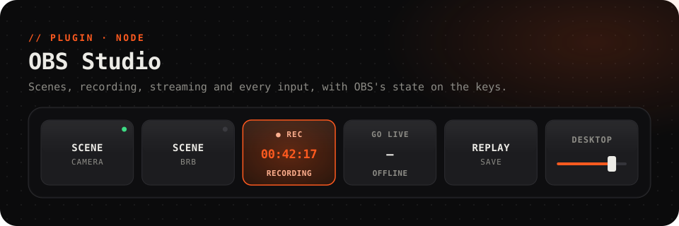

<picture>
  <source media="(prefers-color-scheme: dark)" srcset="../../.github/assets/obs-dark.svg">
  <source media="(prefers-color-scheme: light)" srcset="../../.github/assets/obs-light.svg">
  
</picture>

<p align="center">
  <a href="https://github.com/Questory-Labs/FlexDeck-Plugins/releases?q=obs-v&expanded=true"></a>
  
  
  
</p>

<p align="center">
  Switch scenes, record, stream, save the replay, mute inputs and ride their faders,<br>
  and <b>see what OBS is doing</b>: the live scene, a red light while recording, the running time.
</p>

<br>

## Set up

About a minute. OBS 28 and later have the WebSocket server built in.

1. In OBS, open **Tools → WebSocket Server Settings**.
2. Tick **Enable WebSocket server**. Note the **Server Port** (`4455` unless you changed it).
3. If **Enable Authentication** is ticked, press **Show Connect Info** and copy the **Server Password**. Then press **OK**.
4. In the FlexDeck desktop app, open **Plugins → OBS Studio → Settings**. Fill in the *port* and *password*, and save.

The plugin connects as soon as OBS is running, and reconnects by itself when OBS restarts.

> [!TIP]
> **OBS on another computer?** Put that computer's address in *host*, for example `192.168.1.20`, and make sure its firewall lets port 4455 in. Leave *host* at `127.0.0.1` when OBS runs on the same PC as FlexDeck.

## Ready-made keys

The plugin adds three keys to the gallery, each with its look and its press already wired:

| Key | Press | Look |
| --- | --- | --- |
| **Scene** | Switches to a scene. Pick it under *Does* | Lights while that scene is live |
| **Record** | Starts or stops recording | `● REC` and the time, on red, while recording |
| **Go live** | Starts or ends the stream | `● LIVE` and the time, pulsing red, while live |

## Keys to try

<table>
<tr><th>Key</th><th>How</th></tr>
<tr>
<td><b>A record button with a timer</b></td>
<td><i>Light up while:</i> <code>obs.recording</code><br><i>Label shows:</i> <code>REC {{obs.record_time}}</code></td>
</tr>
<tr>
<td><b>Mic mute with a tally</b></td>
<td><i>Does:</i> <b>Toggle an input's mute</b> on <code>Mic/Aux</code>. It lights by itself while that input is muted.</td>
</tr>
<tr>
<td><b>A fader per input</b></td>
<td>Put <b>Set an input's volume</b> on a slider. It follows OBS, and a tap on its name mutes the input.</td>
</tr>
<tr>
<td><b>Studio mode cut</b></td>
<td>One key per scene with <b>Put a scene in preview</b>, and one big key with <b>Send the preview scene live</b>.</td>
</tr>
<tr>
<td><b>"Be right back"</b></td>
<td><i>Does:</i> <b>Show or hide a source in a scene</b>: your BRB overlay in your main scene.</td>
</tr>
<tr>
<td><b>Clip that</b></td>
<td><i>Does:</i> <b>Save the replay buffer</b>. Start the replay buffer in OBS first.</td>
</tr>
</table>

Scene, input and source names are offered from OBS as you pick them, so they're spelled the way OBS spells them.

## Reference

<details>
<summary><b>Actions</b> (17)</summary>

| Action | Id | Notes |
| --- | --- | --- |
| Switch the live scene | `set_scene` | `scene` |
| Put a scene in preview (studio mode) | `set_preview_scene` | `scene` |
| Send the preview scene live (studio mode) | `transition` | |
| Turn studio mode on or off | `toggle_studio_mode` | |
| Start recording | `start_recording` | |
| Stop recording | `stop_recording` | |
| Start or stop recording | `toggle_recording` | |
| Pause or resume the recording | `toggle_recording_pause` | |
| Go live | `start_streaming` | |
| End the stream | `stop_streaming` | |
| Go live, or end the stream | `toggle_streaming` | |
| Save the replay buffer | `save_replay` | The replay buffer must be running |
| Start or stop the virtual camera | `toggle_virtual_camera` | |
| Toggle an input's mute | `toggle_mute` | `input` |
| Set an input to muted or unmuted | `set_mute` | `input`, `muted` |
| Set an input's volume | `set_volume` | `input`, `percent` 0–100, slider |
| Show or hide a source in a scene | `toggle_source` | `scene`, `source` |

</details>

<details>
<summary><b>Values</b> for labels, lights and conditions</summary>

| Value | |
| --- | --- |
| `obs.connected` | OBS is connected |
| `obs.scene` | The live (program) scene |
| `obs.recording`, `obs.record_paused` | Recording, and paused |
| `obs.record_time` | How long it has recorded, `HH:MM:SS` |
| `obs.streaming`, `obs.stream_time` | Live, and for how long |
| `obs.studio_mode` | Studio mode is on |
| `obs.preview_scene` | The scene in preview, in studio mode; blank outside it |
| `obs.virtualcam` | The virtual camera is on |
| `obs.source.<scene>.<source>.visible` | A source shows in a scene, by their exact names |
| `obs.input.<slug>.muted` | An audio input is muted. `<slug>` is its name in lower case, with anything but letters and digits turned into `_`: `Mic/Aux` → `mic_aux` |
| `obs.input.<name>.muted` | The same, by its exact name: what a mute key lights by |
| `obs.input.<name>.volume` | An audio input's volume, 0–100, by its exact name |

The timecodes are read only while something on the deck shows them.

</details>

<details>
<summary><b>Events</b> for automations</summary>

| Event | Carries |
| --- | --- |
| `connected` | |
| `disconnected` | `reason` |
| `scene_changed` | `scene` |
| `record_state_changed` | `state` |
| `stream_state_changed` | `state` |
| `input_mute_changed` | `input`, `muted` |

</details>

<details>
<summary><b>Settings</b></summary>

| Setting | |
| --- | --- |
| *host* | The computer OBS runs on. Default `127.0.0.1` |
| *port* | OBS's WebSocket port. Default `4455` |
| *password* | The WebSocket server password, if it has one. Kept as a secret on this PC |

</details>

## Troubleshooting

<details>
<summary><b>"OBS is not connected"</b></summary>

- Is OBS running, with **Enable WebSocket server** ticked?
- Does *port* match **Server Port** in OBS?
- For OBS on another computer: is *host* that computer's address, and does its firewall allow the port?

The plugin keeps trying in the background, so once OBS is up, the keys come alive by themselves.
</details>

<details>
<summary><b>"OBS needs a password; set it in the plugin's settings"</b> or <b>"OBS refused the password"</b></summary>

Authentication is on in OBS. Press **Show Connect Info** in **Tools → WebSocket Server Settings**, copy the password, and paste it into *password*.
</details>

<details>
<summary><b>A slider doesn't follow OBS</b></summary>

Very old versions of OBS don't report input volumes. The slider still sets the volume. Update OBS to have it follow.
</details>

## Development

```sh
pnpm --filter @flexdeck/plugin-obs test      # against a fake OBS
pnpm --filter @flexdeck/plugin-obs verify
pnpm --filter @flexdeck/plugin-obs package   # obs-<version>.fdpkg
```
