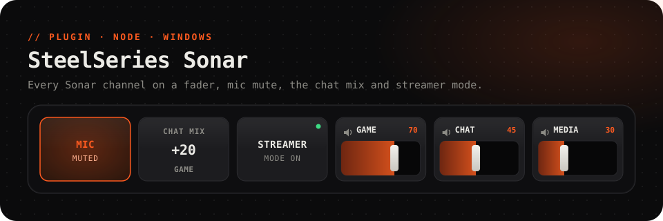

<picture>
  <source media="(prefers-color-scheme: dark)" srcset="../../.github/assets/sonar-dark.svg">
  <source media="(prefers-color-scheme: light)" srcset="../../.github/assets/sonar-light.svg">
  
</picture>

<p align="center">
  <a href="https://github.com/Questory-Labs/FlexDeck-Plugins/releases?q=sonar-v&expanded=true"></a>
  
  
  
</p>

<p align="center">
  Ride every Sonar channel on a fader, mute your mic, slide the chat mix,<br>
  and flip streamer mode, with <b>Sonar's own levels on the keys</b>.
</p>

<br>

## Set up

Nothing to set. Install SteelSeries GG, switch Sonar on in it, and the plugin finds it by itself.

The plugin only talks to Sonar on this computer. GG reports where Sonar listens in `C:\ProgramData\SteelSeries\GG\coreProps.json`; an address that is not on this PC is refused.

## Ready-made keys

| Key | Press | Look |
| --- | --- | --- |
| **Mic mute** | Mutes or unmutes your microphone | Red while muted |
| **Chat mix** | Puts the chat mix back in the middle | The balance between game and chat |

## Keys to try

<table>
<tr><th>Key</th><th>How</th></tr>
<tr>
<td><b>A fader per channel</b></td>
<td>Put <b>Set a channel's level</b> on a slider, one each for <code>game</code>, <code>chat</code>, <code>media</code> and <code>aux</code>. It follows Sonar, and a tap on its name mutes the channel.</td>
</tr>
<tr>
<td><b>Chat mix slider</b></td>
<td>Put <b>Set the chat mix</b> on a slider: all chat on one end, all game on the other.</td>
</tr>
<tr>
<td><b>What the stream hears</b></td>
<td>In streamer mode, <b>Set a channel's level in the stream mix</b> and <b>Mute a channel in the stream mix</b> change the stream without touching your headphones.</td>
</tr>
<tr>
<td><b>Streamer mode</b></td>
<td><i>Does:</i> <b>Switch streamer mode on, or off</b>. <i>Light up while:</i> <code>sonar.streamer_mode</code></td>
</tr>
</table>

## Reference

<details>
<summary><b>Actions</b> (10)</summary>

Channels are `master`, `game`, `chat`, `mic`, `media` and `aux`.

| Action | Id | Notes |
| --- | --- | --- |
| Set a channel's level | `set_volume` | `channel`, `percent` 0–100, slider |
| Turn a channel up or down by a step | `change_volume` | `channel`, `step` −100–100 |
| Mute a channel, or unmute it | `toggle_mute` | `channel` |
| Mute a channel | `mute` | `channel` |
| Unmute a channel | `unmute` | `channel` |
| Set a channel's level in the stream mix | `set_stream_volume` | `channel`, `percent`, slider. Streamer mode |
| Mute a channel in the stream mix, or unmute it | `toggle_stream_mute` | `channel`. Streamer mode |
| Set the chat mix | `set_chat_mix` | `balance` −100 (all chat) to 100 (all game), slider |
| Switch streamer mode on, or off | `toggle_streamer_mode` | |
| Switch streamer mode on or off | `set_streamer_mode` | `mode` `on` or `off` |

</details>

<details>
<summary><b>Values</b> for labels, lights and conditions</summary>

| Value | |
| --- | --- |
| `sonar.connected` | Sonar is running and reachable |
| `sonar.streamer_mode` | Sonar is in streamer mode |
| `sonar.chat_mix` | The chat mix, −100 (all chat) to 100 (all game) |
| `sonar.<channel>.volume`, `sonar.<channel>.muted` | A channel's level, 0–100, and whether it is muted. In streamer mode, your own (monitoring) mix |
| `sonar.<channel>.stream.volume`, `sonar.<channel>.stream.muted` | The same in the stream mix, in streamer mode |

</details>

<details>
<summary><b>Events</b> for automations</summary>

| Event | Carries |
| --- | --- |
| `connected` | |
| `disconnected` | |

</details>

## Troubleshooting

<details>
<summary><b>"SteelSeries GG is not installed"</b>, <b>"is not running"</b> or <b>"Sonar is switched off"</b></summary>

Start SteelSeries GG and switch Sonar on in it. The keys come alive within a few seconds; nothing needs restarting.
</details>

<details>
<summary><b>"the stream mix needs Sonar's streamer mode on"</b></summary>

The stream mix only exists in streamer mode. Switch it on in GG, or with **Switch streamer mode on, or off**.
</details>

<details>
<summary><b>The chat mix moves game and chat instead</b></summary>

Some versions of Sonar have no chat mix to set. The plugin then sets the game and chat levels to the same balance.
</details>

## Development

```sh
pnpm --filter @flexdeck/plugin-sonar test      # against a fake Sonar
pnpm --filter @flexdeck/plugin-sonar verify
pnpm --filter @flexdeck/plugin-sonar package   # sonar-<version>.fdpkg
```
