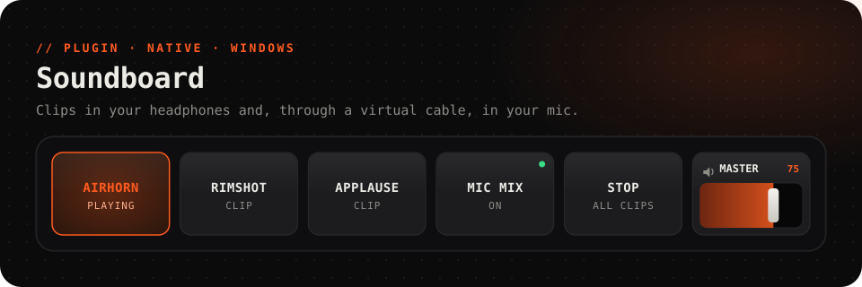
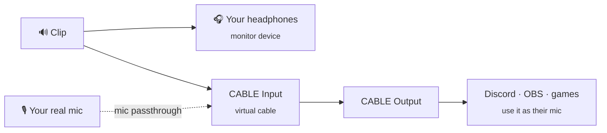

<picture>
  <source media="(prefers-color-scheme: dark)" srcset="../../.github/assets/soundboard-dark.svg">
  <source media="(prefers-color-scheme: light)" srcset="../../.github/assets/soundboard-light.svg">
  
</picture>

<p align="center">
  <a href="https://github.com/Questory-Labs/FlexDeck-Plugins/releases?q=soundboard-v&expanded=true"></a>
  
  
  
</p>

<p align="center">
  Play sound clips from the deck, in your own headphones <b>and into your microphone</b>,<br>
  so your Discord call or your stream hears them too, mixed with your voice.
</p>

<br>

Plays **MP3, WAV, FLAC, Ogg Vorbis and AAC/M4A**, from a file on this computer or an `https://` address. An address is downloaded once and kept.

## How the sound gets around



Your mic goes into the cable only, never into your own headphones.

## Set up

### Hear clips yourself: nothing to set up

Install the plugin and put **Play a clip** on a key. Clips play on Windows' default output, or on the device you name in *monitor device*.

### Play clips into your microphone: five minutes, once

Windows has no way for one program to speak into another program's microphone, so this uses a **virtual audio cable**: a pretend sound card where whatever plays into its *input* comes out of its *output*.

1. **Install a cable.** [VB-CABLE](https://vb-audio.com/Cable/) is free (donationware). Run its installer as administrator, then **restart Windows**. VoiceMeeter and Virtual Audio Cable work too.
2. **Check your defaults.** Installing a cable sometimes makes it Windows' default speakers or microphone. Open **Settings → System → Sound** and set your real headphones and mic back as the defaults.
3. **Point your apps at the cable.** In Discord (**User Settings → Voice & Video → Input Device**), OBS (an *Audio Input Capture* source) or your game, choose **CABLE Output** as the microphone.
4. **Mix your voice in.** In FlexDeck, open **Plugins → Soundboard → Settings**, set *mic passthrough* to `true`, and pick your real microphone in *mic device* (blank means Windows' default microphone).

The plugin finds the cable by itself, and notices if you plug one in later. Now a clip played with output `both` is heard by you and by everyone listening to CABLE Output, along with your voice.

> [!NOTE]
> - Passthrough adds about 20–40 ms of delay to your voice.
> - Windows must let desktop apps use the microphone: **Settings → Privacy & security → Microphone → Let desktop apps access your microphone**.
> - Turn off **noise suppression** (Krisp) in Discord if clips get cut off: it treats them as background noise.

## Keys to try

<table>
<tr><th>Key</th><th>How</th></tr>
<tr>
<td><b>An airhorn that lights while it plays</b></td>
<td><i>Does:</i> <b>Play a clip</b> with <code>C:\Sounds\airhorn.mp3</code>. It lights by itself while that clip plays.</td>
</tr>
<tr>
<td><b>Music bed on / off</b></td>
<td><b>Play a clip</b> with <i>mode</i> <code>toggle</code>: the first press starts it, the next stops it.</td>
</tr>
<tr>
<td><b>Only for you</b></td>
<td><b>Play a clip</b> with <i>output</i> <code>monitor</code>, to check a clip before the room hears it.</td>
</tr>
<tr>
<td><b>Panic button</b></td>
<td><i>Does:</i> <b>Stop every clip</b>.<br><i>Light up while:</i> <code>soundboard.playing</code></td>
</tr>
<tr>
<td><b>Faders</b></td>
<td><b>Set the volume of every clip</b> (0–100), <b>Set one clip's volume</b> (0–100, even mid-clip) and <b>Set the microphone's volume in the mix</b> (0–200) can each drive a slider.</td>
</tr>
<tr>
<td><b>Mic mix switch</b></td>
<td><i>Does:</i> <b>Mix your microphone into the cable, or stop</b> with <code>toggle</code>. It lights by itself while your mic is mixed in.</td>
</tr>
</table>

When you pick a clip in the editor, the 30 you played most recently are offered.

## Reference

<details>
<summary><b>Actions</b> (7)</summary>

| Action | Id | Notes |
| --- | --- | --- |
| Play a clip | `play` | `clip`: a path or `https://` address. `volume` 0–100. `mode`: `restart` it, play another copy over it (`overlap`), or stop it (`toggle`) if it's already playing. `output`: `both`, `monitor` or `cable` |
| Stop a clip | `stop` | `clip` |
| Stop every clip | `stop_all` | |
| Set the volume of every clip | `set_master_volume` | 0–100, slider |
| Set one clip's volume, even while it plays | `set_clip_volume` | `clip`, 0–100, slider |
| Mix your microphone into the cable, or stop | `set_mic_passthrough` | `true`, `false` or `toggle` |
| Set the microphone's volume in the mix | `set_mic_gain` | 0–200, slider |

</details>

<details>
<summary><b>Values</b></summary>

| Value | |
| --- | --- |
| `soundboard.playing` | Any clip is playing |
| `soundboard.playing_count` | How many clips are playing |
| `soundboard.clip.<clip>.playing` | That clip is playing. `<clip>` is the path or address exactly as you gave it |
| `soundboard.clip.<clip>.volume` | That clip's volume |
| `soundboard.master_volume` | The volume of every clip |
| `soundboard.mic_passthrough` | Your mic is mixed into the cable |
| `soundboard.mic_gain` | Your mic's volume in the mix |
| `soundboard.cable.present` | A virtual cable is connected |
| `soundboard.cable.device` | The cable in use |

</details>

<details>
<summary><b>Events</b> for automations</summary>

| Event | Carries |
| --- | --- |
| `clip_started` | `clip` |
| `clip_finished` | `clip`, when it ends or is stopped |

</details>

<details>
<summary><b>Settings</b></summary>

| Setting | |
| --- | --- |
| *monitor device* | Where you hear clips. Blank means the default output |
| *cable device* | The virtual cable's input. Blank means found automatically |
| *mic device* | Your real microphone, for passthrough. Blank means the default |
| *mic passthrough* | Mix your microphone into the cable |
| *master volume* | The volume of every clip, 0–100 |

A device can be named in part, for example `Headphones`, as long as only one device's name contains it.

</details>

<details>
<summary><b>Limits</b></summary>

- A file or download up to **25 MB**, and up to **5 minutes** long. It's a soundboard, not a music player.
- Decoded clips are kept in memory up to 64 MB, so a clip you play often starts instantly.
- Cables found automatically: VB-CABLE, VoiceMeeter (Input, AUX, VAIO3), and Virtual Audio Cable. For anything else, name it in *cable device*.

</details>

## Troubleshooting

<details>
<summary><b>People in the call don't hear the clips</b></summary>

- Is the app's microphone set to **CABLE Output**?
- Does `soundboard.cable.present` say `true`? If not, restart Windows after installing the cable, or name it in *cable device*.
- Was the clip played with output `both` or `cable`?
- Discord's noise suppression may be filtering the clip out. Turn it off, or set *Input Sensitivity* lower.
</details>

<details>
<summary><b>They hear the clips but not me</b></summary>

Turn on *mic passthrough*, and make sure *mic device* is your real microphone and not the cable. If it says *"the microphone could not be opened"*, allow desktop apps to use the microphone in Windows' privacy settings.
</details>

<details>
<summary><b>"… is the cable, so it is not also used to listen"</b></summary>

Your *monitor device*, or Windows' default output, is the virtual cable. Set your real headphones as the default output in **Settings → System → Sound**, or name them in *monitor device*.
</details>

<details>
<summary><b>"no output device matches '…'"</b></summary>

The name in *monitor device* or *cable device* matches no device, or more than one. Use more of the name as Windows shows it in **Settings → System → Sound**.
</details>

<details>
<summary><b>"… could not be decoded" or "… is over 25 MB"</b></summary>

Use one of the formats above, and trim long files. A 5-minute limit applies too.
</details>

<details>
<summary><b>The plugin disappeared after installing</b></summary>

Some antivirus software quarantines new programs that open the microphone. Restore it from quarantine and allow `flexdeck-soundboard.exe`.
</details>

## Development

```sh
cargo test -p flexdeck-plugin-soundboard            # the mixer, decoder and device logic
pnpm --filter @flexdeck/plugin-soundboard build     # release binary into bin/
pnpm --filter @flexdeck/plugin-soundboard package   # soundboard-<version>.fdpkg
```

Builds need Windows. A published binary should be code-signed, because an unsigned new program that opens the microphone is exactly what antivirus software quarantines.
