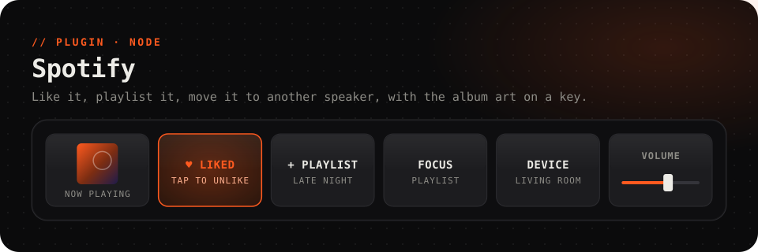

<picture>
  <source media="(prefers-color-scheme: dark)" srcset="../../.github/assets/spotify-dark.svg">
  <source media="(prefers-color-scheme: light)" srcset="../../.github/assets/spotify-light.svg">
  
</picture>

<p align="center">
  <a href="https://github.com/Questory-Labs/FlexDeck-Plugins/releases?q=spotify-v&expanded=true"></a>
  
  
  
</p>

<p align="center">
  Like the song that's playing, drop it in a playlist, start a playlist, album or artist,<br>
  set Spotify's volume on a fader, move playback to another speaker, and <b>put the album art on a key</b>.
</p>

<br>

> [!TIP]
> **Just want play, pause and skip?** You don't need this plugin. FlexDeck's built-in **Media** plugin controls Spotify, TIDAL, Apple Music and any other player, and shows what's playing, without signing in to anything.

> [!IMPORTANT]
> **This plugin needs about two minutes of setup.** Spotify only lets an app in development mode serve the accounts it lists, so you create your own app. It's free, and there's no secret to copy. The steps are below.

## Set up

### 1. Create your Spotify app

1. Open the **[Spotify Developer Dashboard](https://developer.spotify.com/dashboard)** and sign in with your Spotify account. The first time, accept the developer terms.
2. Press **Create app**.
3. Fill in the form:

   | Field | Enter |
   | --- | --- |
   | App name | Anything, for example `FlexDeck` |
   | App description | Anything, for example `My deck` |
   | Website | Leave it blank |
   | **Redirect URIs** | `http://127.0.0.1:47823/callback`, then press **Add** |
   | **Which API/SDKs are you planning to use?** | Tick **Web API** |

4. Accept the terms and press **Save**.

> [!WARNING]
> Type the redirect URI **exactly**: `http://127.0.0.1:47823/callback`. Spotify wants the loopback address written out, so `localhost` won't work, and a missing `/callback` or a different port makes the sign-in fail.

### 2. Copy the Client ID

On your new app's page, open **Settings**. Under **Basic Information**, copy the **Client ID**.

You don't need the Client Secret: the plugin signs in with PKCE, so no secret ever leaves Spotify.

### 3. Paste it into FlexDeck

1. In the FlexDeck desktop app, open **Plugins**, find **Spotify**, and open its **Settings**.
2. Paste the Client ID into *client id*, and save.

### 4. Connect

1. Make a key whose action is **Sign in to Spotify (opens your browser)**, and press it.
2. Your browser opens Spotify's consent page. Check that it names your app, and press **Agree**.
3. The tab says **"flexdeck is connected to Spotify"**. Close it.

That's it. The sign-in is kept and renewed by the plugin, so you won't do this again. You have three minutes to finish in the browser. If you take longer, press the key again.

> [!NOTE]
> **Signing in with a different Spotify account** from the one that owns the app? Add it first: on the app's page, open **User Management** and add that account's name and email. Spotify refuses accounts a development-mode app doesn't list.

## Keys to try

<table>
<tr><th>Key</th><th>How</th></tr>
<tr>
<td><b>Now playing, with album art</b></td>
<td>Set the key's icon to follow <code>{{spotify.art}}</code>, and its label to <code>{{spotify.track}}</code> over <code>{{spotify.artist}}</code>.</td>
</tr>
<tr>
<td><b>A heart that knows</b></td>
<td><i>Does:</i> <b>Like the song that is playing, or unlike it</b>. It lights by itself while the song is liked.</td>
</tr>
<tr>
<td><b>Save to a playlist</b></td>
<td><i>Does:</i> <b>Add the song that is playing to a playlist</b>, picking the playlist from the list.</td>
</tr>
<tr>
<td><b>One-tap playlist</b></td>
<td><i>Does:</i> <b>Play one of your playlists</b>, or <b>Play a song, album, playlist or artist by its Spotify link</b> with a link from <b>Share → Copy link</b>.</td>
</tr>
<tr>
<td><b>Volume fader</b></td>
<td>Put <b>Set Spotify's volume (Premium)</b> on a slider. It follows <code>spotify.volume</code>, so it moves when you change the volume elsewhere.</td>
</tr>
<tr>
<td><b>Send it to the living room</b></td>
<td><i>Does:</i> <b>Move playback to another device</b>, picking the speaker from the list.</td>
</tr>
</table>

### What needs Premium

| Works on any account | Needs Spotify Premium |
| --- | --- |
| Like, unlike, add to a playlist, and everything on the deck: track, artist, liked, album art, device, volume | Setting the volume, starting a playlist, album, artist or song, and moving playback to another device |

On a free account, a Premium-only key says *"that needs Spotify Premium"*. `spotify.premium` tells a key's look which account it's on.

## Reference

<details>
<summary><b>Actions</b> (9)</summary>

| Action | Id | Notes |
| --- | --- | --- |
| Sign in to Spotify (opens your browser) | `connect` | Once, at setup |
| Like the song that is playing | `like_current` | |
| Remove the song that is playing from your liked songs | `unlike_current` | |
| Like the song that is playing, or unlike it | `toggle_like` | Reports `liked` or `unliked` |
| Add the song that is playing to a playlist | `add_to_playlist` | `playlist` |
| Play a song, album, playlist or artist by its Spotify link | `play_uri` | `uri`: an `open.spotify.com` link or a `spotify:` URI. Premium |
| Play one of your playlists | `play_playlist` | `playlist`. Premium |
| Set Spotify's volume (Premium) | `set_volume` | 0–100, slider. Premium |
| Move playback to another device | `transfer_playback` | `device`. Premium |

</details>

<details>
<summary><b>Values</b> for labels, lights and icons</summary>

| Value | |
| --- | --- |
| `spotify.connected` | FlexDeck is signed in to Spotify |
| `spotify.premium` | The account has Premium |
| `spotify.playing` | Spotify is playing |
| `spotify.track` | The track's title |
| `spotify.artist` | Its artists |
| `spotify.liked` | You've liked it |
| `spotify.device` | The device playing |
| `spotify.device_id` | Its id: what a *Move playback* key lights by |
| `spotify.playlist` | The playlist playing, by id; blank when it isn't a playlist |
| `spotify.volume` | Spotify's volume on that device, % |
| `spotify.art` | The album art, for a key's icon |

The player is read at most every three seconds, and only while something on the deck shows it. If Spotify asks the plugin to slow down, it does.

</details>

<details>
<summary><b>Settings</b></summary>

| Setting | |
| --- | --- |
| *client id* | Your Spotify app's Client ID |
| *redirect port* | The port in your Redirect URI. Default `47823` |
| *refresh token* | Kept by the plugin. Clear it to sign out |
| *accounts base*, *api base* | Spotify's services. Leave them as they are |

</details>

## Troubleshooting

<details>
<summary><b>"set your Spotify app's Client ID in this plugin's settings"</b></summary>

Do [step 3](#3-paste-it-into-flexdeck) and save.
</details>

<details>
<summary><b>"not signed in to Spotify yet"</b></summary>

Press your **Sign in to Spotify** key and finish in the browser ([step 4](#4-connect)).
</details>

<details>
<summary><b>Spotify's page says "INVALID_CLIENT: Invalid redirect URI"</b></summary>

The Redirect URI on your app doesn't match what the plugin sent. On the app's page, open **Settings → Edit**, make sure **Redirect URIs** has exactly `http://127.0.0.1:47823/callback` (or your *redirect port* instead of `47823`), and **Save**.
</details>

<details>
<summary><b>"could not listen on 127.0.0.1:47823 for Spotify's answer"</b></summary>

Another program uses port 47823. Pick a free port, say `47824`, put it in *redirect port*, and change the app's Redirect URI to `http://127.0.0.1:47824/callback` to match.
</details>

<details>
<summary><b>"Spotify sign-in was refused: access_denied"</b>, or "user not registered"</summary>

Either you pressed *Cancel* on the consent page, or you signed in with an account the app doesn't list. Add that account under **User Management** on the app's page, then press the sign-in key again.
</details>

<details>
<summary><b>"Spotify is not playing anywhere right now"</b></summary>

Spotify needs an active device to control. Start playing on your phone, PC or speaker first, then use the key.
</details>

<details>
<summary><b>"that needs Spotify Premium"</b></summary>

Spotify only lets apps control playback on Premium accounts. See [What needs Premium](#what-needs-premium).
</details>

<details>
<summary><b>Signing out</b></summary>

Clear *refresh token* in the plugin's settings. To remove the app's access on Spotify's side too, go to **[spotify.com/account/apps](https://www.spotify.com/account/apps/)** and press **Remove access**.
</details>

## Privacy

The plugin talks only to Spotify. Sign-in uses PKCE, so there's no secret to store. The refresh token lives in this plugin's settings, on your computer. The plugin asks Spotify for: `user-read-playback-state`, `user-modify-playback-state`, `user-read-currently-playing`, `user-library-read`, `user-library-modify`, `playlist-read-private`, `playlist-modify-private`, `playlist-modify-public` and `user-read-private`.

## Development

```sh
pnpm --filter @flexdeck/plugin-spotify test      # against a fake Spotify
pnpm --filter @flexdeck/plugin-spotify verify
pnpm --filter @flexdeck/plugin-spotify package   # spotify-<version>.fdpkg
```
