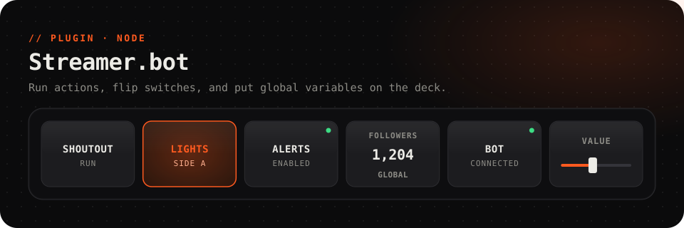

<picture>
  <source media="(prefers-color-scheme: dark)" srcset="../../.github/assets/streamerbot-dark.svg">
  <source media="(prefers-color-scheme: light)" srcset="../../.github/assets/streamerbot-light.svg">
  
</picture>

<p align="center">
  <a href="https://github.com/Questory-Labs/FlexDeck-Plugins/releases?q=streamerbot-v&expanded=true"></a>
  
  
  <a href="https://streamer.bot"></a>
</p>

<p align="center">
  Run <a href="https://streamer.bot">Streamer.bot</a> actions from the deck, with arguments or a fader's value,<br>
  flip between two with one key, switch actions on and off, and <b>show any global variable</b>.
</p>

<br>

## Set up

### Run actions: one minute

1. In Streamer.bot, open **Servers/Clients → WebSocket Server**.
2. Tick **Auto Start**, and press **Start Server**. The defaults (`127.0.0.1`, port `8080`, endpoint `/`) are what this plugin expects.
3. If you turned on **Authentication**, open **Plugins → Streamer.bot → Settings** in FlexDeck and put the same password in *password*.

That's all you need to run actions. Your action list shows up in FlexDeck as you pick, spelled the way Streamer.bot spells it.

### Switch actions on and off: two more minutes

Streamer.bot's WebSocket API can run an action but has no request to enable or disable one. So **Switch an action on**, **off** and **on if it is off** run a small helper action of yours that does it. Create it once:

1. In Streamer.bot's **Actions** tab, right-click the action list and choose **Add**. Name it exactly:

   ```
   flexdeck: set action state
   ```

   Any name works if you put the same one in the plugin's *helper action* setting.
2. Select the new action. In **Sub-Actions**, right-click and choose **Core → C# → Execute C# Code**.
3. Replace the code with this, then press **Compile**, and **Save and Compile**:

   ```csharp
   using System;

   public class CPHInline
   {
       // flexdeck sends: actionId, actionName, enabled (true or false).
       public bool Execute()
       {
           if (!CPH.TryGetArg("actionName", out string name) || string.IsNullOrEmpty(name))
               return false;
           CPH.TryGetArg("enabled", out object raw);
           bool enabled = raw is bool b
               ? b
               : string.Equals(raw?.ToString(), "true", StringComparison.OrdinalIgnoreCase);
           if (enabled)
               CPH.EnableAction(name);
           else
               CPH.DisableAction(name);
           return true;
       }
   }
   ```

### Show global variables on the deck

List the globals you want in the plugin's *globals* setting, separated by commas, for example `followers, last_sub, deaths`. Each becomes a value named `streamerbot.global.<name>`, using the name in lower case with anything but letters and digits turned into `_`.

## Keys to try

<table>
<tr><th>Key</th><th>How</th></tr>
<tr>
<td><b>A shout-out</b></td>
<td><i>Does:</i> <b>Run a Streamer.bot action</b>, with arguments like <code>user=ada;message=hi</code></td>
</tr>
<tr>
<td><b>Lights on / lights off</b></td>
<td><i>Does:</i> <b>Flip between two actions</b>, with a <i>key</i> name like <code>lights</code>.<br><i>Light up while:</i> <code>streamerbot.switch.lights == "a"</code></td>
</tr>
<tr>
<td><b>Pause the alerts</b></td>
<td><i>Does:</i> <b>Switch an action on if it is off, off if it is on</b> (needs the helper).<br><i>Light up while:</i> <code>streamerbot.action.alerts.enabled</code></td>
</tr>
<tr>
<td><b>Follower count</b></td>
<td>Add <code>followers</code> to <i>globals</i>, then <i>Label shows:</i> <code>{{streamerbot.global.followers}}</code></td>
</tr>
<tr>
<td><b>A fader that drives anything</b></td>
<td>Put <b>Run an action with a value</b> on a slider. It sends 0–100 as you drag, as the argument you name (<code>value</code> by default).</td>
</tr>
<tr>
<td><b>A status light</b></td>
<td><i>Light up while:</i> <code>streamerbot.connected</code></td>
</tr>
</table>

## Reference

<details>
<summary><b>Actions</b> (6)</summary>

| Action | Id | Notes |
| --- | --- | --- |
| Run a Streamer.bot action | `run_action` | `action`, optional arguments as `name=value;name2=value2` |
| Run an action with a value | `run_action_value` | `action`, `argument`, `value` 0–100, slider |
| Flip between two actions | `switch` | `key`, `action_a`, `action_b`. Reports `a` or `b`, and remembers it across restarts |
| Switch an action on | `enable_action` | Needs the helper |
| Switch an action off | `disable_action` | Needs the helper |
| Switch an action on if it is off, off if it is on | `toggle_action` | Needs the helper |

</details>

<details>
<summary><b>Values</b></summary>

| Value | |
| --- | --- |
| `streamerbot.connected` | Streamer.bot is connected |
| `streamerbot.version` | Streamer.bot's version |
| `streamerbot.action.<name>.enabled` | One per action: it's enabled. `<name>` in lower case, with anything but letters and digits as `_` |
| `streamerbot.switch.<key>` | Which side a switch is on, `a` or `b` |
| `streamerbot.global.<name>` | A global variable, for each name in *globals* |

</details>

<details>
<summary><b>Events</b> for automations</summary>

| Event | Carries |
| --- | --- |
| `connected` | |
| `disconnected` | `reason` |
| `action_completed` | `action`, `id` |
| `custom` | `data`: a **General → Custom** event's payload, as JSON |
| `global_changed` | `name`, `value`, on Streamer.bot versions that announce it |

</details>

<details>
<summary><b>Settings</b></summary>

| Setting | |
| --- | --- |
| *host* | The computer Streamer.bot runs on. Default `127.0.0.1` |
| *port* | Its WebSocket server's port. Default `8080` |
| *endpoint* | Its WebSocket server's endpoint. Default `/` |
| *password* | The WebSocket password, if authentication is on. Kept as a secret on this PC |
| *globals* | Global variables to show, separated by commas |
| *helper action* | The helper's name. Default `flexdeck: set action state` |

</details>

## Troubleshooting

<details>
<summary><b>"Streamer.bot is not connected"</b></summary>

Check that the WebSocket server is started (**Servers/Clients → WebSocket Server**), and that *host*, *port* and *endpoint* match it. Tick **Auto Start** so it's up whenever Streamer.bot is. The plugin reconnects by itself.
</details>

<details>
<summary><b>"Streamer.bot needs a password"</b> or <b>"Streamer.bot refused the password"</b></summary>

Authentication is on in Streamer.bot. Put the same password in *password*.
</details>

<details>
<summary><b>"Streamer.bot has no action called '…'"</b></summary>

The name doesn't match an action in Streamer.bot. Pick it from the list instead of typing it, or check its spelling. You can also paste an action's id.
</details>

<details>
<summary><b>Enable / disable does nothing</b></summary>

The helper action is missing, misnamed or not compiled. Check that its name matches *helper action* exactly, and that its C# sub-action compiled without errors.
</details>

## Development

```sh
pnpm --filter @flexdeck/plugin-streamerbot test      # against a fake Streamer.bot
pnpm --filter @flexdeck/plugin-streamerbot verify
pnpm --filter @flexdeck/plugin-streamerbot package   # streamerbot-<version>.fdpkg
```
