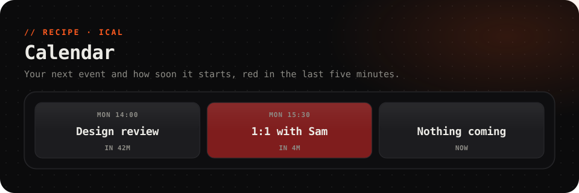

<picture>
  <source media="(prefers-color-scheme: dark)" srcset="../../.github/assets/calendar-dark.svg">
  <source media="(prefers-color-scheme: light)" srcset="../../.github/assets/calendar-light.svg">
  
</picture>

  
  
  
  

  Your next meeting on a key: what it is, when it starts, and how long until then. 
  <b>It turns red and pulses in the last five minutes</b>, so you're never late.

 

## Set up

About a minute. You need your calendar's **secret iCal address**: a private link that serves your calendar as an `.ics` file. No sign-in, no account linking.

1. Get the address from your calendar (below).
2. Install **Calendar** from the Marketplace, and add the **Next meeting** key (2 × 1) from the key gallery.
3. Select it, and under **Its own data**, paste the address into *url*.

> [!CAUTION]
> **Treat the address like a password.** Anyone who has it can read your calendar. If it leaks, your calendar can make a new one and the old one stops working.

### Getting the address

<b>Google Calendar</b>

1. On [calendar.google.com](https://calendar.google.com), press the gear, then **Settings**.
2. Under **Settings for my calendars** on the left, pick the calendar.
3. Press **Integrate calendar**, and copy **Secret address in iCal format**.

If it isn't there, your organisation's admin has switched it off.

<b>Outlook / Microsoft 365</b>

1. In [Outlook on the web](https://outlook.office.com/calendar), open **Settings → Calendar → Shared calendars**.
2. Under **Publish a calendar**, pick the calendar and **Can view all details**, then press **Publish**.
3. Copy the **ICS** link.

<b>Apple iCloud</b>

1. On [icloud.com/calendar](https://www.icloud.com/calendar), press the share icon beside the calendar.
2. Tick **Public Calendar** and copy the link.
3. It starts with `webcal://`. **Change that to `https://`** before you paste it, because FlexDeck only fetches web addresses.

Public means anyone with the link can read it, as with the others.

<b>Anything else</b>

Fastmail, Proton, Nextcloud and most others can share a calendar as an iCal or `.ics` link. Look for *share*, *publish*, *export* or *subscribe* in the calendar's settings. A `webcal://` link works once you change it to `https://`.

## What it shows

| Field | Read as | |
| --- | --- | --- |
| `next` | `{{this.next}}` | The next event's title |
| `at` | `{{this.at}}` | When it starts. The key formats it as `Mon 14:00` |
| `soon` | `{{this.soon}}` | Seconds until it starts. Negative once it has started |
| `where` | `{{this.where}}` | Its location |

It refreshes every 5 minutes. Events that have ended are skipped, so a meeting in progress shows until it's over, and then the next one takes its place. Times are shown in this PC's time zone.

## Troubleshooting

<b>"… is not a web address (http or https)"</b>

The address starts with `webcal://`. Change it to `https://`.

<b>It says "Nothing coming", but I have meetings</b>

- Check that the address is the one for the right calendar: open it in a browser and it should download an `.ics` file.
- **Repeating meetings:** only the first occurrence of a repeating event is read. If your calendar publishes a repeat as one rule rather than as each meeting, a weekly meeting whose first date has passed won't show.

<b>I want two calendars</b>

Add two keys, each with its own address.

---

A recipe is a plugin with no code: [`recipe.json`](recipe.json) describes the web source and the key that shows it. It can only fetch the address you give it, and never reaches your network.
