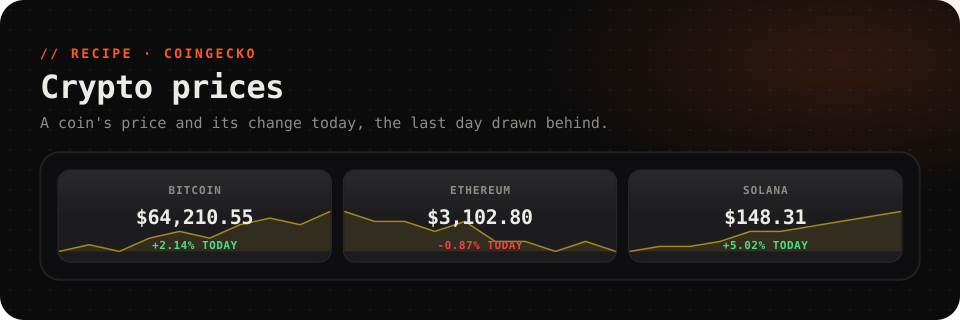

<picture>
  <source media="(prefers-color-scheme: dark)" srcset="../../.github/assets/crypto-dark.svg">
  <source media="(prefers-color-scheme: light)" srcset="../../.github/assets/crypto-light.svg">
  
</picture>

  
  
  
  

  A coin's price on a key, <b>green or red</b> with its change over the last 24 hours, 
  and the last day's price drawn behind. From <a href="https://www.coingecko.com">CoinGecko</a>: no account, no key.

 

## Set up

About 30 seconds.

1. Install **Crypto prices** from the Marketplace.
2. From the key gallery, add the **Crypto ticker** key (2 × 1). It shows Bitcoin in US dollars.

For another coin or currency, select the key and, under **Its own data**:

- set *coin* to CoinGecko's id for the coin, and
- set *in* to the currency, in lower case: `usd`, `eur`, `gbp`, `inr`, `jpy`, or even `btc`.

> [!TIP]
> **Finding a coin's id:** open the coin on [coingecko.com](https://www.coingecko.com). Its **API ID** is listed in the info panel, and it's usually the last part of the page's address: `coingecko.com/en/coins/`**`ethereum`**. Some ids aren't the obvious ones: BNB is `binancecoin`, XRP is `ripple`.

> [!NOTE]
> On a key for another coin, also change the top line, which reads *Bitcoin*. And the line drawn behind comes from the recipe's second source, *Crypto price, the last day*, which runs once for the whole deck with its defaults. To avoid showing Bitcoin's day behind another coin's price, clear the key's background graph.

## What it shows

| Source | Field | Read as | |
| --- | --- | --- | --- |
| *Crypto price* | `price` | `{{this.price}}` | The price now |
| | `change` | `{{this.change}}` | The change over the last 24 hours, % |
| *Crypto price, the last day* | `day` | `src.crypto-chart.day` | The last day's prices, for a graph |

The price refreshes every 2 minutes, and the day's chart every 15.

## Troubleshooting

<b>The price is blank</b>

The *coin* or *in* isn't one CoinGecko knows. Check the coin's **API ID** on CoinGecko, and write the currency in lower case.

<b>It says the source failed, now and then</b>

CoinGecko's free API limits how often it can be asked. A deck with many tickers can hit the limit. They recover on their own at the next refresh.

---

A recipe is a plugin with no code: [`recipe.json`](recipe.json) describes the web sources and the key that shows them. It can only fetch the addresses it names. Prices by [CoinGecko](https://www.coingecko.com). Not financial advice.
