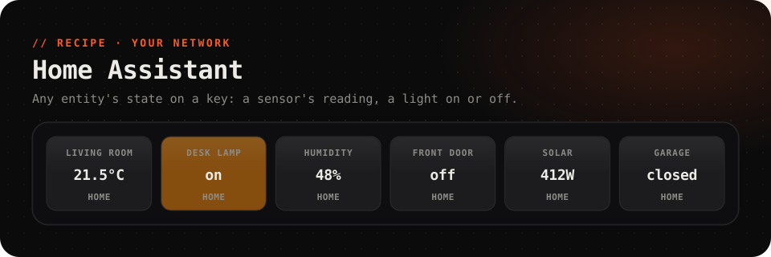

<picture>
  <source media="(prefers-color-scheme: dark)" srcset="../../.github/assets/home-assistant-dark.svg">
  <source media="(prefers-color-scheme: light)" srcset="../../.github/assets/home-assistant-light.svg">
  
</picture>

  
  
  
  

  Any <a href="https://www.home-assistant.io">Home Assistant</a> entity's state on a key: the living room's temperature, 
  the door, the solar panels. <b>A light's key glows amber while it's on.</b> Straight from your network.

 

## Set up

About two minutes, once per Home Assistant.

### 1. Make an access token

1. In Home Assistant, click your name at the bottom left to open your **Profile**, and open the **Security** tab.
2. Scroll to **Long-lived access tokens** and press **Create token**. Name it `FlexDeck`.
3. Copy the token. Home Assistant shows it **only once**.

### 2. Add the key

1. Install **Home Assistant** from the Marketplace, and add the **Home Assistant** key (1 × 1) from the key gallery.
2. Select it, and under **Its own data**, set:

   | | |
   | --- | --- |
   | *url* | Your Home Assistant's address, as you open it in a browser. Default `http://homeassistant.local:8123` |
   | *token* | The token from step 1. It's kept as a secret on this PC |
   | *entity* | The entity's id, for example `sensor.living_room_temperature` |

FlexDeck only lets a web source reach your own network when the source allows it. This one does, with **May reach my network** already on, so there's nothing to switch.

> [!TIP]
> **Finding an entity's id:** in Home Assistant, open **Settings → Devices & services → Entities**, click the entity, and open its settings (the gear). The **Entity ID** is there, like `light.desk_lamp` or `binary_sensor.front_door`.

One key per entity: add as many as you like, each with its own *entity*. They can share the same token.

## What it shows

| Field | Read as | |
| --- | --- | --- |
| `state` | `{{this.state}}` | The state: `21.5`, `on`, `off`, `open`, `home`… |
| `unit` | `{{this.unit}}` | Its unit, if it has one: `°C`, `%`, `W` |
| `name` | `{{this.name}}` | Its friendly name, or its id if it has none |
| `on` | `this.on` | Whether the state is `on`, for a key's look |

It refreshes every 30 seconds. The key shows the name on top, the state and unit in the middle, and glows amber while `on` is true.

## Troubleshooting

<b>"… is on this computer or your network; turn on "May reach my network" to allow it"</b>

FlexDeck keeps web sources away from your own network unless they allow it. This recipe allows it out of the box, so the switch has been turned off: open the Home Assistant source in the editor's data sources and turn **May reach my network** back on.

<b>"homeassistant.local could not be found"</b>

Your network doesn't resolve `.local` names for this PC. Use Home Assistant's IP address instead, for example `http://192.168.1.50:8123`. Your router's device list, or **Settings → System → Network** in Home Assistant, shows it.

<b>The key shows "401" or nothing at all</b>

The token is wrong, or was deleted. Make a new one ([step 1](#1-make-an-access-token)) and paste it into *token*.

<b>The state is blank, or "404"</b>

The *entity* id has a typo. Copy it from Home Assistant as described above.

<b>Using Nabu Casa or a public address?</b>

That works too: put your `https://…ui.nabu.casa` address in *url*. A public address doesn't need *May reach my network*.

---

A recipe is a plugin with no code: [`recipe.json`](recipe.json) describes the web source and the key that shows it. It reads states, and doesn't switch anything. It only asks Home Assistant's REST API for the one entity you name.
