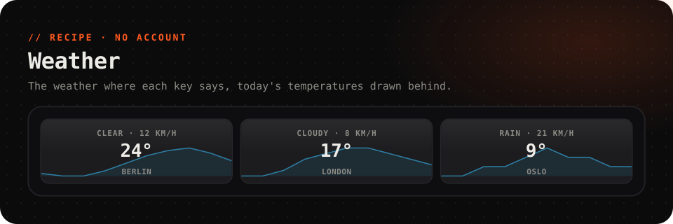

<picture>
  <source media="(prefers-color-scheme: dark)" srcset="../../.github/assets/weather-dark.svg">
  <source media="(prefers-color-scheme: light)" srcset="../../.github/assets/weather-light.svg">
  
</picture>

  
  
  
  

  The temperature, the sky and the wind on a key, with today's temperatures drawn behind. 
  From <a href="https://open-meteo.com">Open-Meteo</a>: free, no account, no key. <b>Each key can show a different place.</b>

 

## Set up

About 30 seconds.

1. Install **Weather** from the Marketplace.
2. From the key gallery, add the **Weather** key (2 × 1).
3. Select it, and under **Its own data**, set *lat* and *lon* to your place's latitude and longitude.

> [!TIP]
> **Finding your coordinates:** in [Google Maps](https://maps.google.com), right-click your town. The first line of the menu is its latitude and longitude, and clicking it copies them. South and west are negative: Sydney is `-33.87`, `151.21`.

Want a second city? Add another Weather key and give it its own place.

## What it shows

| Field | Read as | |
| --- | --- | --- |
| `temp` | `{{this.temp}}` | The temperature now, °C |
| `sky` | `{{this.sky}}` | Clear, Partly cloudy, Rain, Snow, Thunder… |
| `icon` | `{{this.icon}}` | An icon for the sky: `sun`, `cloud`, `cloud-rain`, `cloud-snow`, `bolt` |
| `wind` | `{{this.wind}}` | Wind speed, km/h |
| `today` | `this.today` | Today's temperature, hour by hour, for a graph |

It refreshes every 15 minutes. Use the fields on any key of your own: in **Its own data**, choose the *Weather* source and read them as `{{this.<field>}}`.

## Troubleshooting

<b>It shows the wrong city</b>

The default place is Berlin (`52.52`, `13.41`). Set *lat* and *lon* in the key's **Its own data**.

<b>It says the source failed</b>

FlexDeck couldn't reach `api.open-meteo.com`. Check that the PC is online. A firewall or a filtering DNS may be blocking it. The key tries again at its next refresh.

---

A recipe is a plugin with no code: [`recipe.json`](recipe.json) describes the web source and the key that shows it. It can only fetch the address it names. Weather data by [Open-Meteo](https://open-meteo.com), CC BY 4.0.
